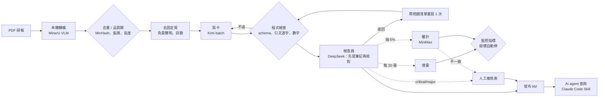

# quant-kb：券商量化研報 → 可驗證的 AI 知識庫

把上百篇 PDF 券商量化研報，自動轉成**每一個說法都能追溯回原文**的結構化「方法卡片」，發布成給 AI agent 查詢的知識庫，用來輔助量化策略開發。

整條流程由多個 LLM 分工（寫卡、檢查、審計），再用程式做逐字核對、用埋雷量測檢查員、用監控指標自動停機，並保留人工最終判定，在**每張卡約 ¥1.3** 的成本下做到可量測的正確性。

## 解決什麼問題

量化研報的價值在細節：因子怎麼構造、參數多少、在哪段區間得到什麼結果。直接讓 LLM 讀 PDF 回答問題，常見的錯誤是：

- 數字張冠李戴（把對照組的收益寫成主方法的）
- 改掉一個數字或一個「不」字，意思完全相反
- 把文獻背景或被否定的做法當成主方法
- 漏掉原文的關鍵步驟

這些錯誤用肉眼很難發現，一旦進了知識庫，agent 會很有信心地引用錯的內容。這個專案的重點不是「讓 LLM 做摘要」，而是**設計一套能抓出 LLM 錯誤、並量測自己抓錯能力的生產線**。

## 成果

| 指標 | 數字 |
|---|---|
| 知識庫 | 121 張卡片，每張附研報全文 |
| 程式檢查第一次通過率 | 88%（85/97） |
| 檢查員退回、重寫後通過 | 2/97 |
| 需要人工升級處理 | 0 |
| 埋雷抓到率 | 9/9（檢查員對已知錯誤的偵測率） |
| 每張通過的卡 | 約 ¥1.33（含寫卡、檢查、重寫、審計） |
| 引文竄改偵測 | 改一個數字 729/729、刪「不」字 126/126 全部擋下 |

## 架構

## 設計重點

### 1. 能用程式驗證的，就不交給模型

模型最常犯的錯（改數字、改否定詞、捏造引文），用程式擋最穩、免費、結果可重現：

- 卡片的每個方法步驟、每個關鍵結果都必須附**逐字原文引文**；程式正規化（去 HTML 標籤、標點、空白）後在全文中精確比對，不接受模糊比對與省略號拼接。
- 關鍵結果的每個數字，必須是**同一列引文裡的完整數字**（`27.9` 不能靠 `27.91` 過關）。
- 從模糊比對改為精確比對前，先用既有 659 條引文驗證：658 條仍能比到，改動不會誤殺。

### 2. 多個模型分工，盲點不重疊

| 角色 | 模型 | 理由 |
|---|---|---|
| 寫卡 | Kimi K3.1 Pro（batch API） | 最需要理解力；batch 打六折 |
| 檢查員 | DeepSeek Flash | 檢查的 token 是寫卡的兩倍以上，放便宜的模型；離峰時段送出 |
| 抽樣審計 | MiniMax M3.1 Flash | 和寫卡、檢查都不同廠，盲點不重疊 |

**檢查員必須先獨立讀原文寫筆記，再核對卡片。**實驗：拿 3 個人工確認的真漏寫重新檢查，有筆記時 5/6 次抓到，沒筆記 0/6——沒讀過原文的檢查員只會核對卡片上「有寫的」，看不出「整段沒提」的內容。

### 3. 量測檢查員本身：埋雷與審計

檢查員說「沒問題」不代表真的沒問題，所以持續量測它：

- **埋雷**：每 20 張通過的卡，自動改一處（數字對調、同大類錯標籤、用 LLM 把一段邏輯改反但保持文筆自然），送檢查員，看它漏抓多少。
- **抽樣審計**：抽 5% 通過的卡給第三個模型再審，找檢查員漏掉的。
- 審計員上線前先**校準**：已知答案的埋雷 7/7、真漏寫 2/3 才採用。
- 實測發現審計員的 major 準確率只有約 1/4，所以**最終判定保留給人工**：程式產生複核表，人工填「真 / 誤報 / 吹毛求疵」，判定寫回帳本後決定卡片如何發布（critical 不發布、major 在卡末標註「已知問題」）。

### 4. 量產時的自動監控

每完成一篇重算五個指標，超過警戒線就停止開始新的篇，必須人工看過才能繼續：

| 指標 | 警戒線 |
|---|---|
| 程式檢查第一次通過率 | < 85% |
| 檢查員退回率 | > 25% |
| 升級率 | > 5% |
| 寫卡或檢查失敗率 | > 10% |
| 埋雷漏抓率 | > 10% |

量產中實際觸發過一次（通過率 84%），停下後人工判斷為正常波動再繼續。

### 5. 花錢的地方都有防呆

- 每個送 API 的指令都要給預算上限，每次呼叫前檢查。
- 送出前查各家餘額，未收回的 batch 也按實測的低估倍率（1.66×）算進去。
- Kimi batch 在驗證階段就會因餘額不足整批失敗：送出後等驗證結果，被拒就把篇放回待送、不記帳，後續 batch 不再送。
- DeepSeek 尖峰時段原價：背景執行一律等到離峰；實際扣款約為記帳原價的三成。
- 每一步都落檔，中斷後重跑只補缺的步驟，不重複花錢。

### 6. 單一帳本、冪等、可重建

- `catalog/manifest.json` 是唯一的狀態來源：每篇的階段、卡片狀態、花費、人工判定、審計、發布紀錄。程式只寫回自己改過的篇，在檔案鎖下合併存檔，可多個程序並行。
- 資料單向流動：生產線 → `kb/`。`kb/` 每次發布都重新產生，壞了可以從生產線重建。
- 被品質閘擋下的篇不會靜默消失，列在待處理清單，人工放行。

### 7. 為下游使用者設計

- 知識庫附 agent 用的說明（`kb/CLAUDE.md`）與 Claude Code Skill：標籤對照、檢索步驟、可信度規則、回答格式（每個結論標來源卡片 id）。
- **市場範圍**：研報都來自中國大陸市場，若要套用到台股、CME 期貨等其他市場，agent 被要求把「方法」與「結論數字」分開，逐條列出結論依賴的大陸市場條件（T+1、漲跌停、融券限制、散戶結構等），並標註「未在目標市場驗證」。新卡片另有附引文的「市場條件」欄位，只記原文事實，不讓模型推測可遷移性。

## 開發過程

1. **POC（20 篇）**：比較 PDF 轉檔工具（MinerU basic / standard）、寫卡模型（Sonnet、MiniMax、本地 Qwen 經 vLLM），以及 agent 檢索的命中率（10/10）。本地模型因編造數字與方法標籤涵蓋率不足而不採用。
2. **試產**：設計卡片 schema v4（每個方法步驟附引文與章節）、檢查員流程、多組評審模型交叉比對、檢查員判定穩定度實驗。
3. **量產**：batch API、自動監控、埋雷與審計、人工複核回寫、發布。
4. 實驗過程完整封存在 `lab/`，正式流程不依賴它。

## 技術

- **Python**：資料管線、JSON Schema 結構化輸出、MinHash 去重、正則數字比對
- **LLM API**：Kimi（batch）、DeepSeek、MiniMax；結構化輸出、離峰排程、餘額與預算控管
- **文件處理**：MinerU（本機 GPU，VLM 模式）PDF → Markdown，表格保留為 HTML
- **Agent 整合**：Claude Code Skill、給 agent 的檢索說明
- **維運**：Bash 背景監控 batch、manifest 狀態機、檔案鎖合併寫入

## 目錄

| 位置 | 內容 |
|---|---|
| `pipeline/` | 全部程式、prompt、詞彙表、查詢 Skill |
| `docs/PIPELINE.md` | 正式流程的完整紀錄：操作手冊、狀態定義、防呆機制、已知缺口 |
| `PLAN.md`、`TODO.md` | 設計理由與待辦 |
| `kb/` | 成品知識庫（發布產生，不進 git） |
| `lab/` | POC 與實驗封存 |

研報 PDF、全文、卡片與帳本屬於資料，不放進版本控制。

## 已知限制

- 超過 12 萬字的因子手冊類研報（一篇上百個因子）一張卡摘不完，目前擋下待之後拆章節處理。
- 數字檢查會把年份、指數名稱（如「沪深300」）裡的數字也當成要核對的值，造成少量不必要的重寫。
- batch 費用的程式估計比實際低約 1.7 倍，目前在餘額預檢中以倍率補償。
