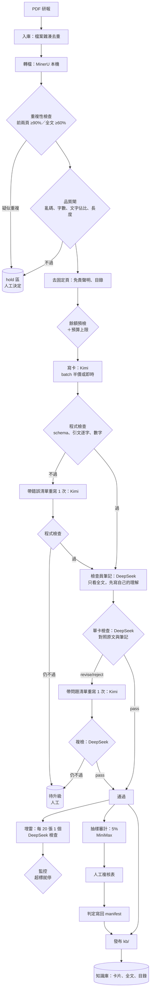

# 研報 → 知識庫：整體流程、防呆機制、LLM 嵌入點

> 2026-11-20 整理，對應 commit `c5112c6` 之後的程式。操作指令見 `pipeline/README.md`，待辦見 `TODO.md`，設計理由見 `PLAN.md`。

## 一句話

PDF 研報經過本機轉檔與清理，交給 Kimi 寫成「每一步都附原文引文」的卡片，先由程式逐字核對引文與數字，再由 DeepSeek 對照原文檢查；通過的卡發布成 `kb/` 知識庫。過程中有埋雷量檢查員、MiniMax 抽樣審計、人工複核，判定寫回 manifest 決定發布方式；任何指標超標就自動停下。

## 是否閉環

**主流程是閉環的**：從 PDF 到可查詢的卡片，每一步的產出都有下一步接手，人工判定能回到發布，監控能讓流程停下。

| 環 | 狀態 |
|---|---|
| PDF → 卡片 → 發布 | 接通，batch1 實跑 46 篇 |
| 檢查不過 → 重寫 → 複檢 | 接通，重寫 1 次為上限 |
| 品質指標 → 自動停下 | 接通（假資料測過，尚未在真實量產觸發過） |
| 埋雷、抽樣審計 → 人工複核表 | 接通，跑完自動做 |
| 人工判定 → manifest → 發布 | 接通，判真的 critical 不發布、major/minor 標「已知问题」 |

**例外路徑還靠人工**（量小，目前可以接受）：

| 缺口 | 現況 |
|---|---|
| 待升級（重寫後仍不過） | 沒有腳本，人工處理。batch1 升級率 0/46 |
| hold 區（疑似重複、品質不過、超長手冊） | 人工決定放行或另行處理；3 篇長手冊待第 23 項 |
| 分流 | 規則驗證過（誤判 0、漏認 2），但還沒接上：週報也寫完整卡，只是多花錢 |
| 檢索（使用端） | 有 `kb/CLAUDE.md`；Skill 與更大規模的檢索測試待第 17 項 |
| 詞彙表維護 | 卡片的 `new_tag_suggestions` 沒人彙整（第 20 項） |

## 流程圖

## 各階段

| 階段 | 做什麼 | 指令 | 用 LLM？ | 每篇花費（實測） |
|---|---|---|---|---|
| 0 入庫 | 檔案雜湊去重，登記 manifest | `batch.py ingest` | 否 | 0 |
| 1 轉檔 | PDF → Markdown（表格是 HTML） | `batch.py convert` | 否（MinerU 本機模型，約 21 秒） | 0 |
| 1a 重複性檢查 | MinHash 比對 | `batch.py dedup` | 否 | 0 |
| 1b 品質閘 | 亂碼、字數、長度 | `batch.py quality` | 否 | 0 |
| 2 去固定頁 | 刪免責聲明、研究小組介紹、目錄 | `batch.py clean` | 否 | 0 |
| 3 分流 | 週報類只寫簡卡 | `run.py triage`（只對照，未接入） | 規則；判不出來才用便宜模型（未做） | — |
| 4 寫卡 | 每個方法步驟附引文與章節 | `run.py submit`／`collect`／`cards` | **是：Kimi K3.1 Pro** | batch 約 ¥0.56，即時約 ¥1.1 |
| 5 程式檢查 | schema、詞彙表、引文、數字 | `validate.py gate_v4`（流程內自動） | 否 | 0 |
| 6 模型檢查 | 獨立筆記 → 核對卡片 | 流程內自動 | **是：DeepSeek Flash** | 約 ¥0.2–0.4（離峰半價） |
| 6b 重寫複檢 | 帶問題清單重寫 1 次 | 流程內自動 | **是：Kimi 寫、DeepSeek 檢** | 只有被退回的篇 |
| 7 升級 | 重寫後仍不過 | 人工（腳本未做） | 原規劃 Opus | — |
| 8 埋雷、審計 | 量檢查員的抓到率與漏抓率 | 流程內自動；也可單獨跑 `run.py canary`、`audit.py` | **是：Kimi（做邏輯雷）、DeepSeek、MiniMax** | 審計約 ¥0.14／張 |
| 9 發布 | 渲染卡片、複製全文、重建目錄 | `publish.py reviews`、`publish.py publish` | 否 | 0 |

batch1 每張通過的卡平均 ¥1.32（含即時寫卡；全走 batch 會更低）。

## 哪些部分嵌入 LLM

### 嵌入點

| 位置 | 模型 | 輸入 | 輸出 | 為什麼用這個模型 |
|---|---|---|---|---|
| 寫卡、重寫 | Kimi K3.1 Pro | 全文、詞彙表、（重寫時）上一版卡片與問題清單 | v4 卡片 JSON | 寫卡最需要理解力；用 batch 拿半價 |
| 檢查員筆記 | DeepSeek Flash | 只有全文 | 參考卡片＋「必須涵蓋」要點 | 先自己讀懂，才看得出卡片漏了什麼 |
| 單卡檢查、複檢 | DeepSeek Flash | 全文、筆記、卡片 | 問題清單（附原文引文）＋ pass/revise/reject | 檢查的 token 是寫卡的兩倍以上，放便宜的模型 |
| 邏輯類埋雷 | Kimi | 卡片的一段文字 | 改反意思的版本 | 要寫得自然，檢查員才不會從文筆認出來 |
| 抽樣審計 | MiniMax M3.1 Flash（max 強度） | 同檢查員：先寫筆記再核對 | 問題清單 | 和寫卡、檢查都不同廠，盲點不重疊；不用 Claude |

### 刻意不用 LLM 的地方

| 位置 | 為什麼 |
|---|---|
| 引文與數字核對 | 逐字比對、正則切數字，比模型可靠、免費、結果固定。模型最常犯的錯（改數字、改否定詞）程式擋得最穩 |
| 去重、品質閘、去固定頁 | 規則夠用，且結果可重現 |
| 監控、發布、判定回寫 | 純統計與檔案處理 |
| 最終判定 | 檢查員和審計員判的 major 都要人工確認；審計員的 major 準確率只有 1/4 |

### 筆記這一步為什麼不能省

三輪測試（2026-11-20）：拿人工確認的 3 個真漏寫重新檢查，有筆記時 5/6 次判 major 退回，沒筆記 0/6。檢查員沒有自己先讀過原文，只會核對卡片上寫了的東西，看不出卡片「整段沒提」的內容。

## 防呆機制

### 花錢之前

| 機制 | 規則 |
|---|---|
| 預算上限 | 送 API 的指令都要給 `--budget`；每次呼叫前檢查，超過就不再送 |
| 餘額預檢 | 送出前查 Kimi、DeepSeek 餘額，低於估計花費的 1.3 倍就不送（MiniMax 沒有查餘額的介面，只靠預算） |
| 先看再送 | `--dry-run` 列出會做什麼；`batch.py status` 用字數估花費 |
| DeepSeek 尖峰 | 北京時間平日 9–12、14–18 是原價：終端機執行時先問 y/N；背景執行一律擋下，要使用者同意才加 `--allow-peak` |
| 餘額不足 | API 回 402 或 billing 錯誤，整批立刻停 |

### 資料進來時

| 機制 | 規則 |
|---|---|
| 檔案去重 | 同一個 PDF（雜湊相同）只入庫一次 |
| 疑似重複 | 前兩頁相似度 ≥ 90% 或全文 ≥ 60% → hold。測過：近似重複、同篇不同轉檔擋得下；只取原文一半以內的節錄擋不下 |
| 品質閘 | 亂碼 ≥ 0.5%、全文 < 2000 字、每頁 < 150 字（多半是掃描版）、文字佔比 < 30%、超過 12 萬字 → hold |
| hold 不靜默 | `hold/<batch>/待處理清單.md` 列出原因，人工放行（`batch.py release`） |

### 卡片的正確性

| 機制 | 擋什麼 |
|---|---|
| schema 與詞彙表 | 欄位缺漏、標籤不在詞彙表 |
| 引文逐字在原文 | 捏造或改過的引文。先去掉標點、空白、HTML 標籤再比；不用省略號拼接。測過：引文改一個數字 729/729、刪「不」字 126/126 都擋下 |
| 數字在同列引文 | value 的數字要是同列引文裡的完整數字（`27.9` 不能靠 `27.91` 過關）。截掉末位 218/221 擋下 |
| 每個方法步驟都附引文 | 沒有原文根據的步驟 |
| 獨立筆記＋單卡檢查 | 方法對象套錯、數字張冠李戴、引文不支持、重要遺漏 |
| 重寫上限 1 次 | 不會無限重試燒錢；仍不過就待升級 |

### 量產時的監控（`monitor.py`）

每做完一篇就重算；超標就不再開始新的篇（已在跑的做完），重跑也會先擋下，處理過才加 `--ignore-alarms`。樣本不到 20 篇（埋雷 10 個）不判，避免誤停。

| 指標 | 警戒 | batch1 實測 |
|---|---|---|
| 程式檢查第一次通過率 | < 85% | 87% |
| 檢查員退回率 | > 25% | 2% |
| 升級率 | > 5% | 0% |
| 寫卡或檢查失敗率 | > 10% | 0% |
| 埋雷漏抓率 | > 10% | 0/7（樣本不足） |

另外兩道持續抽查，跑完 `cards`／`collect` 自動做：

| 抽查 | 做法 | 量什麼 |
|---|---|---|
| 埋雷 | 每 20 張通過的卡改一處（數字對調、同大類錯標籤、邏輯改反），送檢查員 | 檢查員會不會漏抓已知的錯 |
| 抽樣審計 | 抽 5% 通過的卡給 MiniMax 再審一次 | 檢查員漏掉了什麼。batch1 抽 20 張：漏抓 1 張（標籤） |

審計員上線前先校準：7 個埋雷 7/7、3 個真漏寫 2/3 才採用（`audit.py calibrate`）。

### 人工的位置

| 什麼時候 | 看什麼 | 檔案 |
|---|---|---|
| 檢查員判 critical／major | 真、誤報、吹毛求疵 | `pipeline/results/major_review_<batch>.md` |
| 審計和檢查員不一致 | 同上 | `pipeline/results/audit_review_<batch>.md` |
| 監控警報 | 哪一項超標、建議怎麼處理 | 終端機訊息、`run.py report` |
| hold 區、待升級 | 放行、另行處理或丟棄 | `hold/<batch>/`、`run.py report` |

判定填完跑 `publish.py reviews <batch>` 寫回 manifest：

| 判為真的問題 | 發布時 |
|---|---|
| 第一次檢查抓到、卡片之後重寫過 | 已處理，不算 |
| critical，仍在卡上 | 不發布 |
| major／minor，仍在卡上 | 發布，卡末加「已知问题」，frontmatter `known_issues` 記條數 |

判定詞要寫在最前面；開頭認不出的列成「看不懂」，不猜。重新產生複核表時，已填的判定會保留。

### 中斷與並行

| 機制 | 規則 |
|---|---|
| 每步落檔 | 卡片、筆記、檢查結果都存檔；重跑從缺的那一步接續，不重複花錢 |
| 重試間隔 | 暫時性錯誤重試 3 次，間隔 10／30／90 秒 |
| manifest 合併存檔 | 檔案鎖下「讀檔、合併、寫檔」；每個程式只寫回自己改過的篇的 `card` 欄位。人工判定（`review`）、審計（`audit`）、發布紀錄（`published`）放在 `card` 之外，不會被蓋掉 |
| batch 與即時分開 | `collect` 只碰從 batch 收回的篇，不和同時在跑的 `cards` 搶同一篇 |

## 產出

| 位置 | 內容 | 進 git？ |
|---|---|---|
| `catalog/manifest.json` | 每篇每階段的狀態、花費、判定 | 否 |
| `cards/<batch>/` | 卡片 JSON（`.v1.json` 是重寫前） | 否 |
| `eval/<batch>/` | 筆記、檢查、埋雷、審計結果 | 否 |
| `kb/` | 發布的知識庫：`cards/*.md`、`fulltext/*.md`、`catalog.jsonl`、`CLAUDE.md` | 否 |
| `pipeline/results/` | 人工複核表 | 是 |

## 換成訂閱制（`claude -p`）時要改的地方

所有模型呼叫都經過 `run.py` 的 `call_model`，換掉這個函式即可；監控、埋雷、審計、發布不用動。要另外處理：

1. 花費改用 `claude -p` 回報的等值金額當預算；餘額預檢改成額度檢查。
2. 碰到 5 小時或每週額度上限，要像等離峰一樣暫停等恢復，不能算失敗（否則失敗率警報會擋下整批）。
3. 寫卡若改用 Claude，檢查員和審計員仍要用別家模型。
4. 800 篇約要 3000 多次呼叫，額度可能比錢更先用完。
