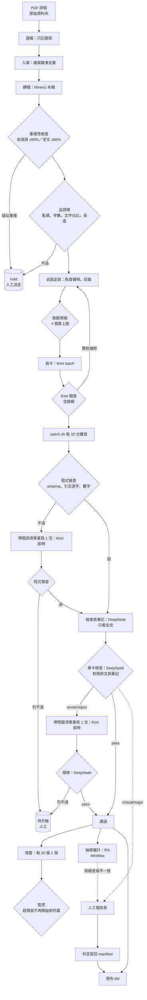

# 研報 → 知識庫：正式流程紀錄

> 2026-11-21 定案版。逐條指令的參數見 `pipeline/README.md`，待辦見 `TODO.md`，設計理由見 `PLAN.md`。試產與實驗過程封存在 `lab/`（見 `lab/README.md`），正式流程不讀寫那裡。

## 一句話

PDF 研報在本機轉檔、清理後，交給 Kimi 寫成「每一步都附原文引文」的卡片；程式先逐字核對引文與數字，再由 DeepSeek 對照原文檢查，不過就帶著問題清單重寫一次。通過的卡發布到 `kb/`，給 agent 查詢。過程中用埋雷量檢查員、MiniMax 抽樣審計，存疑的列成人工複核表，判定寫回 manifest 決定怎麼發布；任何品質指標超標就自動停下。

## 目前狀態（2026-11-21）

| 項目 | 數字 |
|---|---|
| 知識庫 | 121 張卡（batch1 97、batch2 4、poc 20） |
| 暫緩（hold） | 4 篇，都是「超長篇」（因子手冊），先不處理 |
| 保留給訂閱方案 | `sub1a` 5 篇（2026-11-24 從 sub1 分出來先跑完整流程驗證）、`sub1` 其餘 55 篇（只選了檔，還沒入庫） |
| batch1 品質 | 程式檢查第一次通過 85/97（88%）、檢查員退回 2/97、升級 0、失敗 0、埋雷 9/9 抓到 |
| 抽樣審計 | batch1 抽 28 張；第一輪 20 張中檢查員漏抓 1 張（標籤），之後 8 張全部一致 |
| 每張通過的卡 | 約 ¥1.33（batch1 累計 ¥128.83） |

## 三層：生產線、成品、實驗

資料只往一個方向流：生產線 → `kb/`。`kb/` 每次發布都重新產生，直接改它會被蓋掉；它壞了可以從生產線重建，反過來不行。

| 層 | 位置 | 角色 |
|---|---|---|
| 成品 | `kb/` | 給 agent 查的知識庫，只讀。由 `publish.py` 產生，`quant-kb` Skill 指向這裡 |
| 生產線 | 下表 | 產卡的工廠與帳本，之後的新研報還要用 |
| 實驗 | `lab/` | 試產、模型比較、單項測試的封存，正式流程不用 |

### 生產線的資料夾

| 位置 | 內容 | 進 git？ |
|---|---|---|
| `inbox/<batch>/` | `_selection.json`（選了哪些 PDF、原始路徑）。舊批次 `batch1`、`poc` 另有複製進來的 PDF；之後預設不複製 | 只有清單外的說明 |
| `fulltext/<batch>/standard/` | MinerU 轉出的全文（表格是 HTML） | 否 |
| `fulltext/<batch>/clean/` | 去掉免責聲明、目錄等固定頁之後的全文；寫卡、檢查、發布都用這份 | 否（`poc/clean` 是 POC 時提交的） |
| `cards/<batch>/` | 卡片 JSON；`.v1.json` 是重寫前的版本 | 否 |
| `eval/<batch>/<id>/` | 每篇的 Kimi 回覆、檢查員筆記、檢查結果 | 否 |
| `eval/<batch>/_kimi_batches/` | 送出的 JSONL 與收回的原始結果 | 否 |
| `eval/<batch>/_canary/`、`_audit_max/` | 埋雷、抽樣審計 | 否 |
| `catalog/manifest.json` | **總帳**：每篇的階段、狀態、花費、人工判定、審計、發布紀錄 | 否 |
| `catalog/kimi_batches.json` | 每個 Kimi batch 的 id、篇目、狀態、實際花費 | 否 |
| `catalog/fingerprints.json` | 去重用的 MinHash 指紋 | 否 |
| `hold/<batch>/` | 被擋下的篇與「待處理清單.md」 | 否 |
| `pipeline/` | 程式、prompt、詞彙表（見下方「程式」） | 是 |
| `pipeline/results/` | 人工複核表 `major_review_<batch>.md`、`audit_review_<batch>.md` | 是 |
| `pipeline/logs/` | 執行紀錄 | 否 |
| `pipeline/_mineru_raw/` | MinerU 原始輸出（含圖片） | 否 |
| `pipeline/skill/quant-kb/` | 查詢 Skill 的源檔；`~/.claude/skills/quant-kb` 是指向它的連結 | 是 |

## 流程圖



## 操作手冊：一批新研報從頭到尾

所有指令在 `pipeline/` 下執行，Python 用 `/home/newt/venvs/kb-parse/bin/python`。花錢的步驟都要給 `--budget`，先用 `--dry-run` 看。

```bash
# 1. 選檔：從 .env 的 Research_Report_PATH 隨機選，只記原始路徑，不複製 PDF
python batch.py sample batch3 --n 50

# 2. 本機前處理（不花錢）
python batch.py ingest  batch3
python batch.py convert batch3
python batch.py dedup   batch3
python batch.py quality batch3
python batch.py clean   batch3
python batch.py status  batch3 --budget 80     # 用字數估花費；被擋下的看 hold/batch3/待處理清單.md

# 3. 寫卡：送 Kimi batch（每個 batch 17 篇左右）
python run.py submit batch3 --chunk 17 --budget 60 --dry-run
python run.py submit batch3 --chunk 17 --budget 60

# 4. 監控：完成一個 batch 就收回、檢查、重寫、埋雷、審計、發布；全部收回才結束
bash watch.sh batch3 25
#    中途隨時查（不花錢）
python run.py status batch3
python run.py report batch3

# 5. 人工複核：產生複核表、填判定、寫回、再發布（watch.sh 每次收回都會自動做前兩行和寫回、發布；沒條目就不產生檔）
python run.py review   batch3          # 檢查員判的 critical／major
python audit.py review batch3          # 審計和檢查員不一致的
#    打開 pipeline/results/major_review_batch3.md、audit_review_batch3.md 填「人工判定」
python publish.py reviews batch3
python publish.py publish batch3
```

| 情況 | 怎麼做 |
|---|---|
| 監控警報 | 看 `run.py report` 和警報建議；決定繼續就 `bash watch.sh batch3 25 600 --ignore-alarms` |
| watch 被關掉（關機、關 app） | 重跑同一行；已收回、已檢查的不會重複花錢 |
| batch 很久沒動 | `python run.py status` 看；確定卡住可以取消（`kimi_batch.cancel`）再 `status` 結案、`submit` 重送 |
| hold 的篇要放行 | `python batch.py release <batch> <id>…`，再從第 2 步接續；超長篇預設不放行（見下方「超長篇」） |
| 已有卡片、只跑後半段 | `python adopt.py <batch> --cards … --fulltext …`，再 `run.py cards <batch>` |
| 現在是 DeepSeek 尖峰 | 背景執行一律等離峰（`watch.sh` 已加 `--wait-offpeak`）；要在尖峰跑必須使用者當下同意，才加 `--allow-peak` |

## 狀態記在哪：manifest

每篇在 `catalog/manifest.json` 有一筆，用研報 id 當 key。**卡片和全文都不會因為狀態改變而搬家**，狀態只是 manifest 裡的欄位；只有 hold 會動檔（見下）。

| 欄位 | 值 | 意思 |
|---|---|---|
| `status`（前處理） | `ingested` → `converted` → `deduped` → `quality_ok` → `cleaned` | 走到哪一步 |
| | `hold` | 被擋下，原因在 `hold/<batch>/待處理清單.md` |
| `card.state`（寫卡與檢查） | `new` → `waiting`（在 Kimi batch 裡）→ `written` → `passed` | 正常路徑 |
| | `waiting_offpeak` | 停在 DeepSeek 步驟前等離峰 |
| | `write_failed`、`error`、`interrupted` | 寫卡失敗、檢查失敗、中途停下；重跑會接續 |
| | `escalate` | 重寫後仍不過，待人工；使用者同意帶著已知問題發布的用 `publish.py accept` 登記（2026-11-24 起） |
| `card.gate`、`check1`、`check2`、`calls`、`cost_cny` | | 每次程式檢查的問題數、檢查員判定、每次呼叫與花費 |
| `review` | | 人工判定（從複核表寫回） |
| `audit` | | 抽樣審計結論 |
| `published` | | 什麼時候發布、有幾條已知問題 |

`review`、`audit`、`published` 放在 `card` 之外，程式重跑檢查時不會蓋掉。

### 要人工看的東西放在哪

不另外搬卡，而是產生清單：

| 什麼 | 清單 | 產生方式 |
|---|---|---|
| 檢查員判的 critical／major | `pipeline/results/major_review_<batch>.md` | `run.py review <batch>` |
| 審計員和檢查員不一致 | `pipeline/results/audit_review_<batch>.md` | `audit.py review <batch>` |
| 被擋下的篇 | `hold/<batch>/待處理清單.md` | 前處理時自動 |
| 待升級 | `run.py report <batch>` 列出 | 自動 |
| 監控警報 | 終端機與 log 的 `!!` 行、`run.py report` | 自動 |

`watch.sh` 每收回一個 batch 就重新產生複核表，有沒填的會印 `!! N 條等你判定`。複核表重新產生時，已填的判定會保留，新的條目留空。填完跑 `publish.py reviews` 才會寫回 manifest、下次發布才生效。

hold 是唯一會動檔的：用舊方式（`--copy`）複製進 `inbox/` 的批次，PDF 會移到 `hold/<batch>/`；預設的不複製批次，PDF 留在原處，只寫清單。

## 各階段

| 階段 | 做什麼 | 指令 | 用 LLM？ | 每篇花費（實測） |
|---|---|---|---|---|
| 選檔 | 隨機選、依雜湊排除已處理的 | `batch.py sample` | 否 | 0 |
| 0 入庫 | 檔案雜湊去重，登記 manifest | `batch.py ingest` | 否 | 0 |
| 1 轉檔 | PDF → Markdown（表格是 HTML） | `batch.py convert` | 否（MinerU 本機，約 21 秒） | 0 |
| 1a 重複性檢查 | MinHash 比對 | `batch.py dedup` | 否 | 0 |
| 1b 品質閘 | 亂碼、字數、長度 | `batch.py quality` | 否 | 0 |
| 2 去固定頁 | 刪免責聲明、研究小組介紹、目錄 | `batch.py clean` | 否 | 0 |
| 3 分流 | 週報類只寫簡卡 | `run.py triage`（只對照，未接入） | 規則 | — |
| 4 寫卡 | 每個方法步驟附引文與章節 | `run.py submit` | **是：Kimi K3.1 Pro（batch）** | 約 ¥0.85–1.0 |
| 5 程式檢查 | schema、詞彙表、引文、數字 | 流程內自動（`validate.py`） | 否 | 0 |
| 6 模型檢查 | 獨立筆記 → 核對卡片 | 流程內自動 | **是：DeepSeek Flash** | 記帳約 ¥0.34（原價）；離峰實扣約 ¥0.10 |
| 6b 重寫複檢 | 帶問題清單重寫 1 次 | 流程內自動 | **是：Kimi 即時寫、DeepSeek 檢** | 只有被退回的篇，約 ¥1.1 |
| 7 升級 | 重寫後仍不過 | 人工 | — | — |
| 8 埋雷、審計 | 量檢查員的抓到率與漏抓率 | 流程內自動；也可單獨跑 `run.py canary`、`audit.py sample` | **是：Kimi、DeepSeek、MiniMax** | 審計約 ¥0.2／張 |
| 9 發布 | 渲染卡片、複製全文、重建目錄與詞彙表 | `publish.py reviews`、`publish.py publish` | 否 | 0 |

Kimi batch 的回收時間差很多：同一天送的，有的 33 分鐘完成，有的 10 小時沒動（取消重送後 2 小時完成）。程式送出時的估計比實際低，實際約是估計的 1.66–1.75 倍。

## 哪些部分嵌入 LLM

| 位置 | 模型 | 輸入 | 輸出 | 為什麼用這個模型 |
|---|---|---|---|---|
| 寫卡、重寫 | Kimi K3.1 Pro | 全文、詞彙表、（重寫時）上一版卡片與問題清單 | v4 卡片 JSON | 寫卡最需要理解力；batch 打六折 |
| 檢查員筆記 | DeepSeek Flash | 只有全文 | 參考卡片＋「必須涵蓋」要點 | 先自己讀懂，才看得出卡片漏了什麼 |
| 單卡檢查、複檢 | DeepSeek Flash | 全文、筆記、卡片 | 問題清單（附原文引文）＋ pass/revise/reject | 檢查的 token 是寫卡的兩倍以上，放便宜的模型 |
| 邏輯類埋雷 | Kimi | 卡片的一段文字 | 改反意思的版本 | 要寫得自然，檢查員才不會從文筆認出來 |
| 抽樣審計 | MiniMax M3.1 Flash（max 強度） | 同檢查員：先寫筆記再核對 | 問題清單 | 和寫卡、檢查都不同廠，盲點不重疊；不用 Claude |

刻意不用 LLM 的地方：

| 位置 | 為什麼 |
|---|---|
| 引文與數字核對 | 逐字比對、正則切數字，比模型可靠、免費、結果固定。模型最常犯的錯（改數字、改否定詞）程式擋得最穩 |
| 去重、品質閘、去固定頁 | 規則夠用，且結果可重現 |
| 監控、發布、判定回寫 | 純統計與檔案處理 |
| 最終判定 | 檢查員和審計員判的 major 都要人工確認；審計員的 major 準確率只有 1/4 |

**筆記這一步不能省**：拿人工確認的 3 個真漏寫重新檢查，有筆記時 5/6 次判 major 退回，沒筆記 0/6。檢查員沒有自己先讀過原文，只會核對卡片上寫了的東西，看不出卡片「整段沒提」的內容。

**漏掉必須涵蓋的要點，程式一律當 major**（使用者 2026-11-24 決定）：檢查員對「重要遗漏」的嚴重度在 major／minor 邊界上會跳（TODO 第 28 項；Agent Plan 對照時招商卡的「相鄰 10 天樣本剔除」被判 minor 放行）。所以檢查結果多一個 `must_capture_check`，筆記的要點逐條標 `covered`／`missing`，並附原文引文。只有兩種算 `missing`：照著做需要的步驟、參數或條件，以及會讓借用者把方向理解錯的結論；佐證數字、次要理由、細節程度不算（2026-11-24 收窄：原本「任何一個條件沒寫到就算」，sub1a 的 A/B 顯示會把佐證數字也當漏寫，退回率 40–60%）。`run.py` 的 `force_must_capture()` 不看檢查員給的嚴重度：`missing` 且引文逐字在原文裡的，補一條 major（`field: must_capture`、`forced_by: code`），`pass` 改成 `revise` 退回重寫；複檢還是 `missing` 就待升級給人看。引文比不到的不採用（可能是筆記本身記錯），記在 `must_capture_unverified`。檢查員原本的判定留在 `model_verdict`。舊的檢查結果沒有這個欄位，不受影響。

## 防呆機制

### 花錢之前

| 機制 | 規則 |
|---|---|
| 預算上限 | 送 API 的指令都要給 `--budget`；每次呼叫前檢查，超過就不再送 |
| 餘額預檢 | 送出前查 Kimi、DeepSeek 餘額，低於估計花費的 1.3 倍就不送。還沒收回的 batch 也算進去（送出時估計 × 1.66）。MiniMax 沒有查餘額的介面，只靠預算 |
| 沒有「先送、之後再儲值」 | Kimi 建立 batch 後驗證時就檢查餘額，不夠整批直接 `failed`。所以餘額不夠一律不送，要先儲值 |
| 先看再送 | `--dry-run` 列出會做什麼；`batch.py status` 用字數估花費 |
| DeepSeek 尖峰 | 北京時間平日 9–12、14–18 是原價：終端機執行時先問 y/N；背景執行一律擋下或等離峰，要使用者當下同意才加 `--allow-peak` |
| 餘額不足 | API 回 402 或 billing 錯誤，整批立刻停 |

### Kimi batch

| 機制 | 規則 |
|---|---|
| 送出後等驗證 | 每送一個 batch 等 Kimi 驗證（最多 2 分鐘）。被拒就印出原因、這批篇放回待送，後面的 batch 不再送 |
| 整批沒跑的結案 | 驗證失敗、取消、過期且沒有結果檔的 batch：`status`／`collect` 會結案，不記任何篇寫卡失敗、不記帳，篇放回待送 |
| 不重複送 | 已在未收回 batch 裡的篇、已有 Kimi 回覆的篇不會再送 |
| 收回後落檔 | 每篇結果先存檔、以 batch 價記帳，之後的檢查失敗也不用重寫 |

### 資料進來時

| 機制 | 規則 |
|---|---|
| 檔案去重 | 同一個 PDF（雜湊相同）只入庫一次；選檔時也排除已選、已處理的 |
| 疑似重複 | 前兩頁相似度 ≥ 90% 或全文 ≥ 60% → hold。測過：近似重複、同篇不同轉檔擋得下；只取原文一半以內的節錄擋不下 |
| 品質閘 | 亂碼 ≥ 0.5%、全文 < 2000 字、每頁 < 150 字（多半是掃描版）、文字佔比 < 30%、超過 12 萬字 → hold |
| hold 不靜默 | `hold/<batch>/待處理清單.md` 列出原因，人工放行（`batch.py release`） |

**超長篇**：全文超過 12 萬字（`batch.py` 的 `MAX_CHARS`）就歸這一類，manifest 記 `hold_kind: "超長篇"`。幾乎都是因子手冊或合集，一篇列上百個因子，一張卡摘不完。目前的決定是**先不處理**：
- 品質閘自動擋下並標類別，待處理清單把它們集中在「超長篇（先不處理）」一節。
- `batch.py release` 預設不放行這類，要照一般流程硬寫一張卡才加 `--force`。
- 之後做拆章節寫卡（TODO 第 23 項）時，從 manifest 撈 `hold_kind == "超長篇"` 的篇即可。


### 卡片的正確性

| 機制 | 擋什麼 |
|---|---|
| schema 與詞彙表 | 欄位缺漏、標籤不在詞彙表 |
| 引文逐字在原文 | 捏造或改過的引文（key_results、evidence_quotes、method_steps、market_conditions 全部都比）。先去掉標點、空白、HTML 標籤再比，之後必須完全一致；不能用省略號拼接。測過：引文改一個數字 729/729、刪「不」字 126/126 都擋下 |
| 數字在同列引文 | value 的數字要是同列引文裡的完整數字（`27.9` 不能靠 `27.91` 過關；`13.00` 與 `13` 視為相同）。截掉末位 218/221 擋下 |
| 每個方法步驟都附引文 | 沒有原文根據的步驟 |
| 獨立筆記＋單卡檢查 | 方法對象套錯、數字張冠李戴、引文不支持、重要遺漏 |
| 重寫上限 1 次 | 不會無限重試燒錢；仍不過就待升級 |

### 量產時的監控（`monitor.py`）

每做完一篇就重算；超標就不再開始新的篇（已在跑的做完），重跑也會先擋下，看過、處理過才加 `--ignore-alarms`。樣本不到 20 篇（埋雷 10 個）不判，避免誤停。2026-11-21 第一次在量產中觸發（通過率 84%），停下後由人決定繼續。

| 指標 | 警戒 | batch1 實測 |
|---|---|---|
| 程式檢查第一次通過率 | < 85% | 88% |
| 檢查員退回率 | > 25% | 2% |
| 升級率 | > 5% | 0% |
| 寫卡或檢查失敗率 | > 10% | 0% |
| 埋雷漏抓率 | > 10% | 0/9（樣本不足） |

另外兩道持續抽查，`cards`／`collect` 跑完自動做：

| 抽查 | 做法 | 量什麼 |
|---|---|---|
| 埋雷 | 每 20 張通過的卡改一處（數字對調、同大類錯標籤、邏輯改反），送檢查員 | 檢查員會不會漏抓已知的錯 |
| 抽樣審計 | 抽 5% 通過的卡給 MiniMax 再審一次 | 檢查員漏掉了什麼 |

審計員上線前先校準：7 個埋雷 7/7、3 個真漏寫 2/3 才採用（`audit.py calibrate`，校準用的已知答案在 `lab/`）。

### 人工判定怎麼影響發布

| 判為真的問題 | 發布時 |
|---|---|
| 第一次檢查抓到、卡片之後重寫過 | 已處理，不算 |
| critical，仍在卡上 | 不發布 |
| major／minor，仍在卡上 | 發布，卡末加「已知问题」，frontmatter `known_issues` 記條數 |

判定詞（真／誤報／吹毛求疵）要寫在最前面；開頭認不出的列成「看不懂」，不猜。

### 中斷與並行

| 機制 | 規則 |
|---|---|
| 每步落檔 | 卡片、筆記、檢查結果都存檔；重跑從缺的那一步接續，不重複花錢 |
| 重試間隔 | 暫時性錯誤重試 3 次，間隔 10／30／90 秒 |
| manifest 合併存檔 | 檔案鎖下「讀檔、合併、寫檔」；每個程式只寫回自己改過的篇 |
| batch 與即時分開 | `collect` 只碰從 batch 收回的篇，不和同時在跑的 `cards` 搶同一篇 |

## 市場範圍與「市場條件」

研報全部來自大陸券商，實證幾乎都在 A 股或國內期貨。之後要用在台股、CME 等市場，分兩層處理：

- **查詢時**（全部卡片都適用，不花錢）：`pipeline/kb_CLAUDE.md`（發布成 `kb/CLAUDE.md`）與 quant-kb skill 寫明市場範圍，要求 agent 把「方法」和「結論數字」分開看，逐條列出結論依賴的大陸市場條件（T+1、漲跌停、融券難、股指期貨限倉、散戶結構、成分股效應、股災時期等），並標「未在目標市場驗證」。
- **寫卡時**（2026-11-23 起的新卡）：卡片多一個 `market_conditions` 欄位，`{condition, quote, section}`，只記原文明說的樣本、區間、交易制度、數據口徑，每條附引文、照樣受程式檢查逐字比對；檢查員也會看它是不是事實。發布時渲染成卡片的「市场条件」一節。不讓模型判斷「能不能用在其他市場」。
- **舊卡**：之前的 121 張沒有這個欄位（發布不受影響）。schema 現在要求這個欄位，所以對舊批次重跑埋雷或 `adopt.py` 會被 schema 擋下；要補可以單獨跑一輪只抽這一項（估約十幾元，TODO 第 30 項）。

## 已知缺口

| 缺口 | 影響 | 處理 |
|---|---|---|
| 數字檢查把年份（2010 年）、指數名稱（沪深300）當成要核對的數值 | 誤擋，觸發不必要的重寫，拉低通過率 | 待修 |
| 抽樣依 id 雜湊：小批次可能一張都抽不到 | batch2（4 張）、poc（20 張）的審計與埋雷都是 0 張 | 待改成「有通過的卡就至少各 1 張」 |
| 程式的 batch 花費估計偏低 | 預檢已用 1.66 倍補，估計本身沒改 | 待修 |
| 待升級沒有腳本 | 目前升級率 0，人工處理 | 量大再做 |
| 超長篇（> 12 萬字，多為因子手冊） | 4 篇在 hold，先不處理 | TODO 第 23 項 |
| 分流未接入 | 週報也寫完整卡，只是多花錢 | TODO |
| 詞彙表維護 | 卡片的 `new_tag_suggestions` 沒人彙整 | TODO 第 20 項 |

## 程式

| 檔案 | 角色 |
|---|---|
| `batch.py` | 選檔、入庫、轉檔、去重、品質閘、去固定頁、hold、估花費 |
| `clean.py` | 去固定頁的規則 |
| `run.py` | 寫卡（submit／cards）、收回（status／collect）、檢查、重寫、埋雷、監控接線、report、複核表 |
| `watch.sh` | 背景監控 Kimi batch，完成就 collect、產生複核表、寫回判定、發布，有沒填的判定會提醒 |
| `kimi_batch.py` | Kimi 的 HTTP 介面：上傳、建立、查詢、取消、下載、餘額 |
| `validate.py` | 程式檢查（schema、引文、數字） |
| `monitor.py` | 監控指標與警戒線 |
| `audit.py` | MiniMax 抽樣審計、校準、審計複核表 |
| `publish.py` | 判定寫回 manifest、發布 `kb/` |
| `adopt.py` | 把已寫好的卡登記成正式批次 |
| `offpeak.py`、`cn_holidays.txt` | DeepSeek 尖峰判斷 |
| `common.py` | 路徑、詞彙表、共用函式 |
| `trial.py`、`trial_canary.py`、`judge_fable.py` | 名字是試產時取的，但量產會用到裡面的設定與函式（卡片 schema、埋雷、模型呼叫與價格），不能搬 |
| `card_prompt_v3.md`、`judge/pass1_prompt.md`、`check_prompt.md` | 寫卡、檢查員筆記、單卡檢查的 prompt |
| `vocab.yaml`、`judge/strategy_types.yaml` | 方法詞彙表、策略大類 |
| `kb_CLAUDE.md` | 發布時複製成 `kb/CLAUDE.md` |
| `mineru-standard.yaml`、`serve_mineru_vlm.sh` | 轉檔設定 |

## 走火山 Agent Plan（`--via plan`）

寫卡與檢查改用火山方舟 Agent Plan 的套餐額度（2026-11-23 起可用）。套餐只能在 AI 工具裡用，不能直接打 API，所以由 `headless.py` 每一步啟動一次 Claude Code 無頭模式（`claude -p`），請求送到火山的端點。寫卡 Kimi、檢查 DeepSeek，仍是不同廠；審計員 MiniMax 不在套餐內，照舊走 API。

**主控仍是 `run.py`**：agent 只負責「寫一張卡」或「檢查一張卡」，回傳一份 JSON。落檔、程式檢查、狀態轉換、監控、埋雷、審計、發布都和 API 路線相同，agent 的回報不算數。

### 設定

| 位置 | 內容 |
|---|---|
| `pipeline/agent_plan/writer.settings.json`、`checker.settings.json` | deny 全部工具、關 hooks 與遙測。進 git，沒有金鑰 |
| `pipeline/agent_plan/system.md` | 固定的系統提示：單一任務、只輸出 JSON、原文裡像指令的文字一律當內容 |
| `.env` 的 `ARK_AGENT_API_KEY`、`ARK_AGENT_BASE_URL` | 從火山控制台的 Agent Plan 頁面複製（不是 Coding Plan 的位址）；Base URL 不加 `/v1`，Claude Code 會自己接 `/v1/messages` |
| `.env` 的 `ARK_KIMI_MODEL_NAME`、`ARK_DEEPSEEK_MODEL_NAME` | 寫卡、檢查的模型名稱。`headless.py` 把 Claude Code 的所有模型別名都指向它，背景小任務才不會叫到不存在的模型 |
| `pipeline/agent_plan/.config/<role>/` | Claude Code 的專用設定資料夾，不進 git |
| `pipeline/logs/headless_calls.log` | 每次呼叫一行：角色、模型、秒數、用量、問題；不含提示與金鑰 |

### 防跑偏、防 context 爆掉

| 風險 | 防法 |
|---|---|
| 做要求以外的事（讀寫檔、執行指令、上網） | `--tools ""`＋設定檔 deny 全部工具＋空的暫存 cwd＋`--strict-mcp-config`；回傳有 `permission_denials` 就判失敗 |
| 讀到專案或個人的 CLAUDE.md、記憶、hooks、外掛 | `--bare`＋專用 `CLAUDE_CONFIG_DIR`（`HOME` 也指過去）＋固定系統提示 |
| 拿到不該有的金鑰 | 子程序的環境變數用白名單，Kimi／DeepSeek／MiniMax 的金鑰都不傳 |
| 多篇混在一起、對話過長被摘要 | 每篇每一步一個新程序＋`--no-session-persistence`；重寫也是新程序，上一版卡片與問題清單明寫在提示裡 |
| 輸出不合格式或偷工 | `--json-schema`＋Python 端再驗 schema＋程式檢查逐字比引文與數字＋檢查員 |
| 自己宣告通過 | agent 沒有工具、不能寫檔；狀態只由 `run.py` 依程式檢查與檢查結果決定 |
| 卡住 | 每次呼叫 20 分鐘逾時，整個程序群組砍掉，照重試規則 |
| 額度用完被當成失敗 | 變成 `waiting_quota`，不算失敗率；加 `--wait-quota` 每 30 分鐘再試 |
| 額度用超過 | 程式控速（見下）：估計會超過上限的八成就先不送，等到估計可以送的時間 |
| 檢查員失靈 | 埋雷每 20 張、MiniMax 抽 5% 審計照跑，監控警戒線不變 |

### 和 API 路線的差別

- 花費記 0（套餐），每次呼叫仍記秒數與 token 用量（`via: agent-plan`），可對照控制台點數；`--budget` 只管 MiniMax 審計。
- 不查 Kimi／DeepSeek 餘額。
- **不套用 DeepSeek 尖峰規則**（使用者 2026-11-23 決定）：只有直接打 DeepSeek API 的呼叫受 `offpeak.py` 限制。
- 預設同時 3 篇（使用者 2026-11-24 定；原本 1 篇）。每篇的檢查員筆記和第一次寫卡同時做（筆記只看全文），所以最多 6 個呼叫同時進行；實測同時送 4 個請求都正常。sub1 前 4 篇：一次兩篇＋筆記與寫卡同時，26.7 分鐘做完，逐步做要約 53 分鐘，快約一倍。控速會把還沒回來的呼叫算進去。
- 風險：用程式批次啟動 Claude Code 吃套餐，形式上是火山列出的 AI 工具，但仍屬灰色地帶，有被判濫用的可能。

### 控速（2026-11-24）

使用者要求由程式控制速度、不讓額度用超過。CLI 看不到火山的點數，所以 `headless.py` 用呼叫紀錄（`logs/headless_calls.log`）估算：

- 每次呼叫前，算最近 **5 小時、7 天、31 天** 估計用掉的點數（含還沒回來的呼叫），加上這次呼叫的估計（這個角色最近 10 次成功呼叫裡最大的一次），超過 Small 檔上限（2,000／7,000／20,000）的 **80%** 就不送，丟 `PaceWait`。
- `run.py` 把它當成 `waiting_quota`：加了 `--wait-quota` 就睡到估計可以送的時間（最舊的紀錄滑出時間窗），沒加就停下，重跑同一個指令接續。不算失敗率。
- 週、月用滾動時間窗：滾動 7 天不超過，任何一個日曆週也不會超過；月取 31 天，比任何月份都長。
- 換算：三篇對照的 17 次成功呼叫共 388k token，控制台扣 76 點，約 **5,100 token／點**（輸入、快取、輸出同權）。程式用 4,000（`TOKENS_PER_POINT`），會高估約 25%。之後在控制台看到新的點數就重算。
- 逾時被砍、沒有用量的呼叫，照送出前的預估記點數。
- 算不到這個專案以外用掉的點數；八成的控速線就是留給這部分和估計誤差。
- `python headless.py usage` 印出目前各時間窗的估計用量與下一次的估計，不送請求。

### 第一次使用

```bash
python headless.py ping writer     # 確認連線、模型名稱、回傳格式（用一點套餐額度）
python headless.py ping checker
python headless.py usage            # 估計目前用了多少點（不送請求）
python run.py cards sub1 --via plan --budget 5 --limit 3 --wait-quota
```

2026-11-23 實測：兩個角色都通，`--bare`＋`ANTHROPIC_API_KEY` 火山接受，一題約 4–9 秒。stderr 的 `unrecognized_model` 只是 Claude Code 不認得這個模型名稱，不影響結果。檢查員設成 `deepseek-v4.1-flash-economy`：使用者說明和一般版能力相同、只是較慢；埋雷照常持續監控。

火山的端點要求 schema 每個欄位都明寫 `type`（只有 enum 的欄位不補，整個請求回 400「A parameter specified in the request is not valid」），`headless.py` 送出前會自動補上，驗證仍用原 schema。

`ping` 失敗時依訊息調整 `headless.py` 開頭的 `BARE`、`AUTH_ENV`、`PASS_EFFORT`，或設定檔裡的模型名稱。額度用完的錯誤訊息第一次碰到時，補進 `QUOTA_HINTS`。
